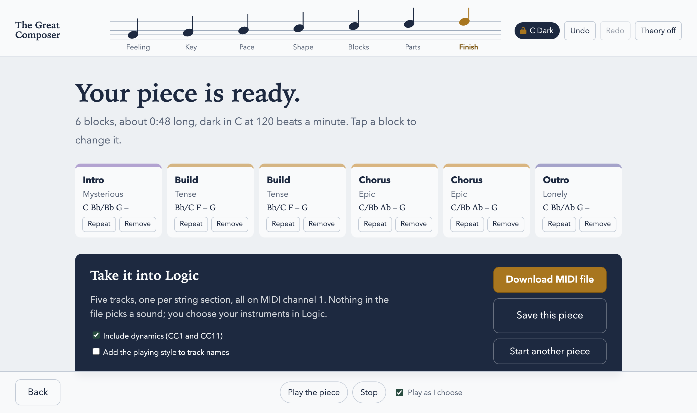

# THE GREAT COMPOSER

Chords in, orchestral arrangement out. A step-by-step scoring tool for people with little music theory: you press buttons, hear each choice, and export a layered MIDI file for Logic Pro or any other DAW.

> Made by **Rob Cawley**, a musician in Dublin, for his own records, and shared free for anyone to try.
> If you make something with it, I'd love to hear it. Share it in [Made with it](https://github.com/robcawley/the-great-composer/discussions/categories/made-with-it) or post it anywhere, and if you like, link back to my music:
> **[robcawley.com](https://robcawley.com)** · **[Bandcamp](https://robcawley.bandcamp.com)** · the new album **[Room Tone](https://robcawley.com/roomtone/)**.

## How it works

One decision per screen, and you hear every option before you choose it:

1. **Feeling:** pick a mood.
2. **Key:** choose a key and lock it in, so nothing you add later can go out of key.
3. **Pace:** tempo (or tap it) and meter.
4. **Shape:** a loop, a sketch, a slow build or a full song.
5. **Each section:** its emotion, its chords (from a palette that only offers chords in your key), and how it moves.
6. **Parts:** build the strings from the basses up, hearing each part over the ones before.
7. **Finish:** review the timeline and download the MIDI.

The export is a Type 1 MIDI file with one track per part, all on channel 1, with tempo, meter, key and section markers and no program changes, so you choose the sounds in your own DAW. The same choices always give the same file. Your piece is saved in the browser as you go.

## Try it

It runs in your browser and needs nothing online. You need [Node.js](https://nodejs.org):

    git clone https://github.com/robcawley/the-great-composer.git
    cd the-great-composer
    npm install
    npm run dev

Then open the address it prints. `npm test` runs the test suite.

## Sister projects (Logic Pro plug-ins)

- [NEON RIOT](https://github.com/robcawley/neon-riot): a heavy bass synthesizer.
- [ROB KIT](https://github.com/robcawley/rob-kit): a human-feeling drum instrument.
- [BRUISER](https://github.com/robcawley/bruiser): a drummer that plays ROB KIT.
- [UNDERTOW](https://github.com/robcawley/undertow): an ambient space effect.

## Licence

MIT (see `LICENSE`). The preview samples are original and CC0 (see `THIRD_PARTY.md`).
